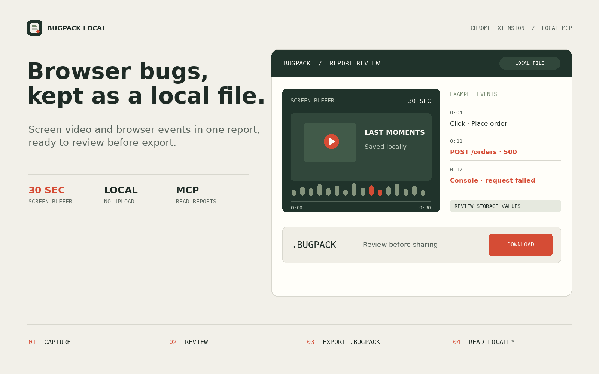
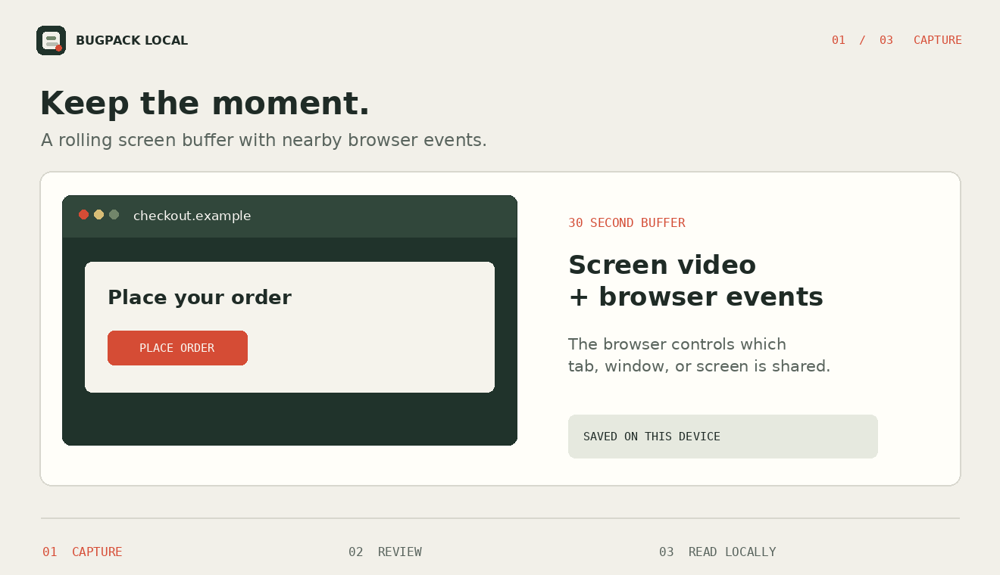
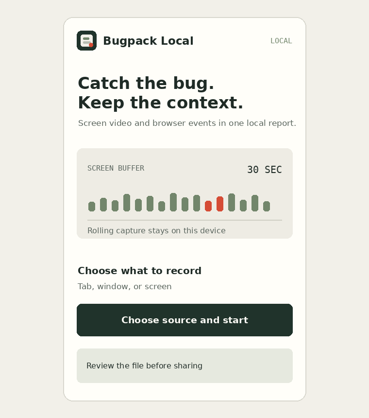
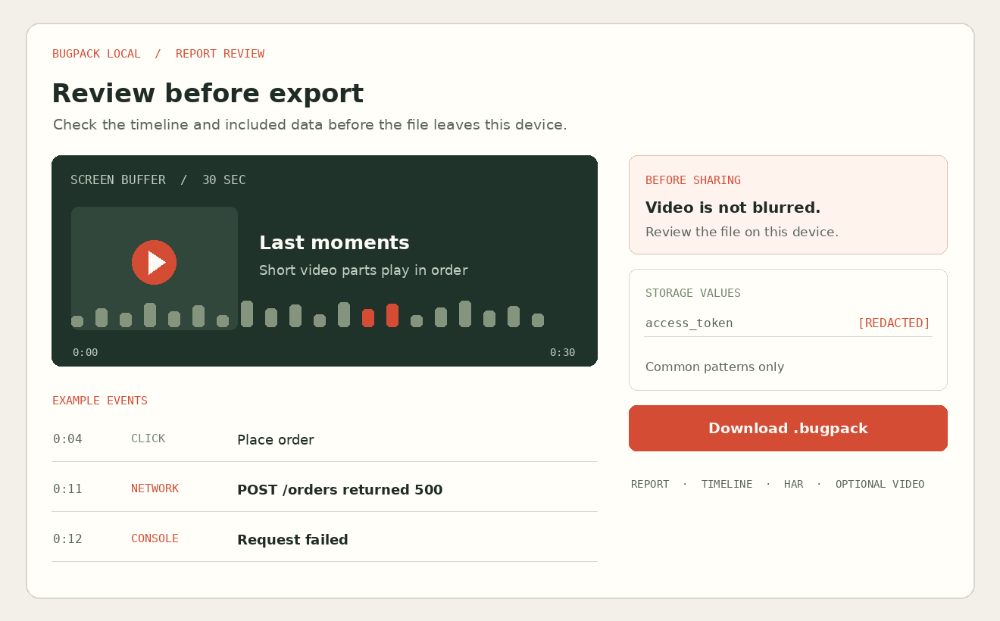

<div align="center">
  
  <p><a href="https://github.com/hilsetapp/bugpack-local/releases/download/v0.1.2/bugpack-local-extension.zip"><strong>Download the extension preview</strong></a> · <a href="https://github.com/hilsetapp/bugpack-local/releases">Releases</a> · <a href="README.ru.md">Русский</a></p>
</div>

# Bugpack Local

A Chrome/Chromium extension and local MCP reader for browser bug reports. Capture up to 30 seconds of screen video with nearby browser events, review the package, then export one `.bugpack` file.

## Capture, review, read

<div align="center">
  
</div>

<details>
  <summary>Popup and report previews</summary>
  <p><strong>Extension popup</strong></p>
  
  <p><strong>Report review</strong></p>
  
</details>

The browser's own prompt selects a tab, window, or screen. Page events come from the active tab when capture starts. A draft can be reviewed, edited, or discarded before download.

### Included

- A rolling screen buffer of up to 30 seconds, saved as short WebM parts.
- Clicks and form actions without typed values, console output, uncaught exceptions, and fetch/XHR method, URL, status, and duration.
- Local Storage and Session Storage values from report time. Common secret fields and token-shaped strings are masked.
- A readable report, event timeline, English and Russian coding prompts, and a basic HAR.
- A local MCP server with `list_bugpacks`, `get_bug_context`, and `get_bugpack_file` tools.

### Not included or guaranteed

- No account, upload service, or audio capture.
- No request or response bodies, headers, images, or complete record of browser resources. The HAR covers fetch/XHR entries only.
- No general Redux or framework-store capture.
- Video is not blurred. Pattern-based redaction can miss sensitive values. Review the bundle before sharing it.

## Install

The extension targets Chrome and Chromium browsers with Manifest V3. **Screen capture has not been manually verified in Chrome for this preview build.**

1. Download [`bugpack-local-extension.zip`](https://github.com/hilsetapp/bugpack-local/releases/download/v0.1.2/bugpack-local-extension.zip) and unzip it.
2. Open `chrome://extensions`, enable **Developer mode**, and select **Load unpacked**.
3. Choose the extracted extension folder and pin Bugpack Local.
4. Open the page to test, start capture, and select a tab, window, or screen in the browser prompt.
5. Reproduce the issue. Press `Alt+Shift+B` or choose **Save bug report**.
6. Review the draft and download the `.bugpack` file.

Choose a capture source that does not expose passwords or personal data. Screen video is not blurred.

## Read a bundle with MCP

The MCP server reads the folder supplied on the command line. It does not make network requests or browse arbitrary paths.

```sh
npm ci
node cli/index.js mcp ~/Downloads/Bugpack
```

For Claude Code, from the repository folder:

```sh
claude mcp add bugpack-local -- node /absolute/path/to/bugpack-local/cli/index.js mcp ~/Downloads/Bugpack
```

Without MCP, list or inspect a package directly:

```sh
node cli/index.js list ~/Downloads/Bugpack
node cli/index.js inspect ~/Downloads/Bugpack/report-id.bugpack
```

## Build and test

```sh
npm ci
npm test
npm run test:syntax
npm run pack:extension
```

`npm run pack:extension` creates `bugpack-local-extension.zip` in the project folder. The README artwork can be regenerated with `python3 scripts/make-assets.py` (requires Pillow).

## Package contents

```text
report.json       structured report
report.md         readable report
prompt.md         English coding prompt
prompt.ru.md      Russian coding prompt
events.json       timestamped browser events
network.har       basic fetch/XHR entries
storage.json      Local Storage and Session Storage values
video/            short WebM parts, when included
replay.html       local player for the video parts
```

`.bugpack` is a ZIP archive with a different extension. The extension and MCP reader are in this repository; the exported report remains a local file.
