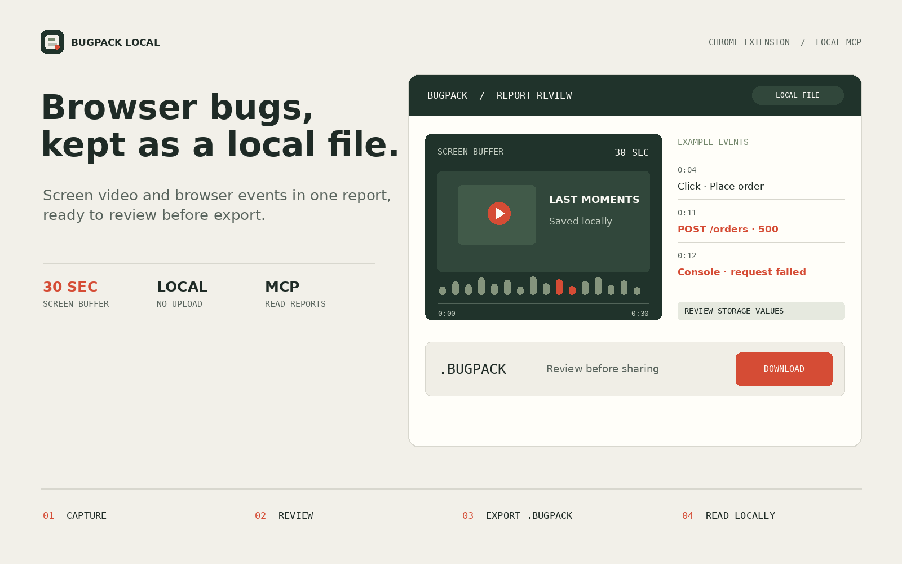
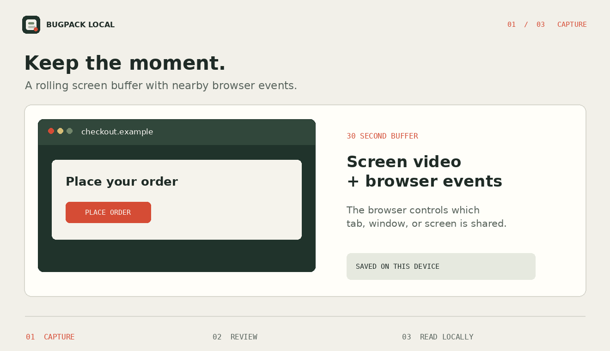
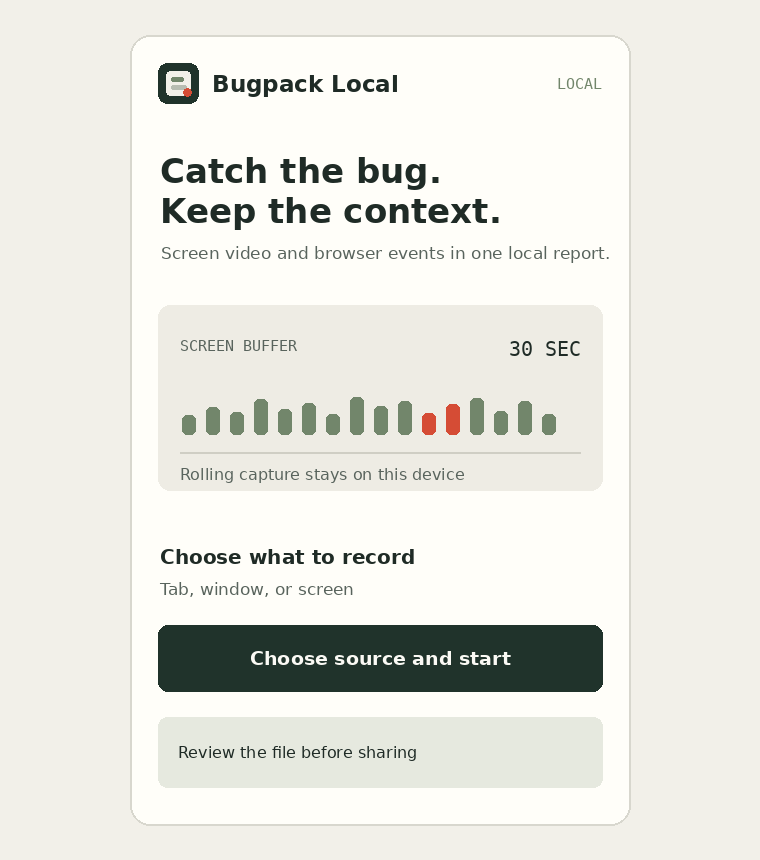
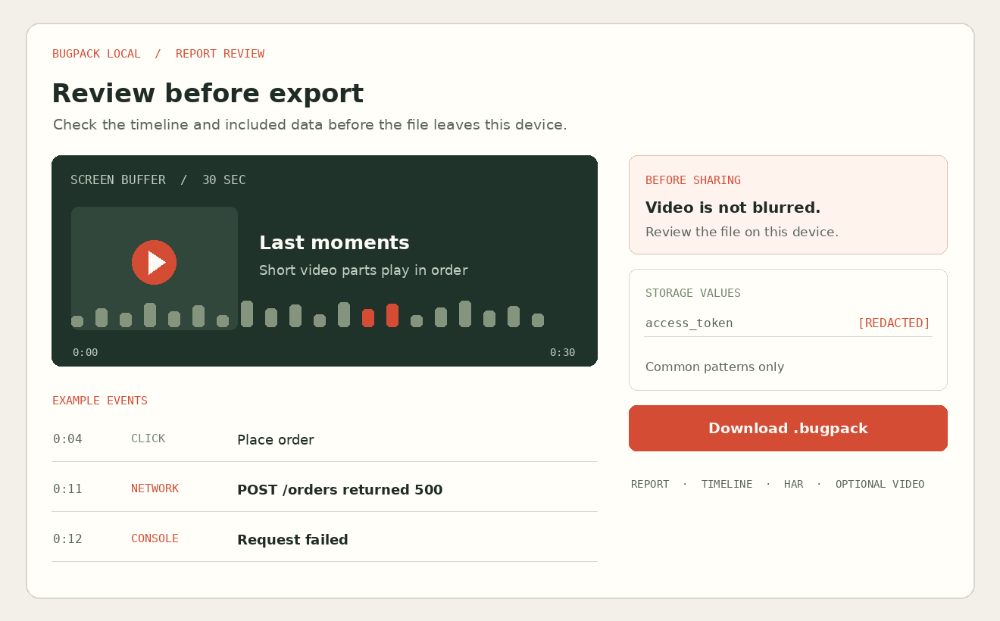

<div align="center">
  
  <p><a href="https://github.com/hilsetapp/bugpack-local/releases/download/v0.1.2/bugpack-local-extension.zip"><strong>Скачать предварительную сборку</strong></a> · <a href="https://github.com/hilsetapp/bugpack-local/releases">Релизы</a> · <a href="README.md">English</a></p>
</div>

# Bugpack Local

Расширение для Chrome и Chromium и локальный MCP-ридер для багрепортов из браузера. Сохраняет до 30 секунд видео экрана и связанные события браузера, позволяет проверить пакет и выгрузить его одним файлом `.bugpack`.

## Захват, проверка, чтение

<div align="center">
  
</div>

<details>
  <summary>Предварительный вид окна и отчёта</summary>
  <p><strong>Окно расширения</strong></p>
  
  <p><strong>Проверка отчёта</strong></p>
  
</details>

Источник выбирается в стандартном окне браузера: вкладка, окно или экран. События страницы записываются из активной вкладки на момент запуска. Перед скачиванием черновик можно проверить, изменить или удалить.

### Что входит

- Скользящий буфер экрана до 30 секунд, сохранённый короткими WebM-фрагментами.
- Клики и действия с формами без введённых значений, сообщения консоли, необработанные исключения, метод, URL, статус и длительность запросов fetch/XHR.
- Значения Local Storage и Session Storage на момент создания отчёта. Распространённые секретные поля и строки, похожие на токены, маскируются.
- Читаемый отчёт, таймлайн событий, промпты для кодера на английском и русском, базовый HAR.
- Локальный MCP-сервер с инструментами `list_bugpacks`, `get_bug_context` и `get_bugpack_file`.

### Ограничения

- Нет аккаунта, загрузки отчётов на сервер или записи звука.
- Нет тел запросов и ответов, заголовков, изображений и полного списка ресурсов браузера. HAR содержит только записи fetch/XHR.
- Расширение не считывает Redux и другие хранилища фреймворков в общем случае.
- Видео не размывается. Фильтр по шаблонам может пропустить чувствительные данные. Перед отправкой проверь файл.

## Установка

Расширение рассчитано на Chrome и Chromium с Manifest V3. **Захват экрана вручную не проверялся в Chrome для этой предварительной сборки.**

1. Скачай [`bugpack-local-extension.zip`](https://github.com/hilsetapp/bugpack-local/releases/download/v0.1.2/bugpack-local-extension.zip) и распакуй архив.
2. Открой `chrome://extensions`, включи **Режим разработчика** и выбери **Загрузить распакованное расширение**.
3. Укажи распакованную папку и закрепи Bugpack Local.
4. Открой страницу для проверки, запусти захват и выбери вкладку, окно или экран в окне браузера.
5. Воспроизведи проблему. Нажми `Alt+Shift+B` или выбери **Сохранить багрепорт**.
6. Проверь черновик и скачай файл `.bugpack`.

Не записывай пароли и личные данные. Видео экрана автоматически не размывается.

## Чтение через MCP

MCP-сервер читает указанную в команде папку. Он не отправляет сетевые запросы и не просматривает произвольные пути на компьютере.

```sh
npm ci
node cli/index.js mcp ~/Downloads/Bugpack
```

Для Claude Code, из папки репозитория:

```sh
claude mcp add bugpack-local -- node /absolute/path/to/bugpack-local/cli/index.js mcp ~/Downloads/Bugpack
```

Без MCP пакет можно перечислить или проверить командой:

```sh
node cli/index.js list ~/Downloads/Bugpack
node cli/index.js inspect ~/Downloads/Bugpack/report-id.bugpack
```

## Сборка и тесты

```sh
npm ci
npm test
npm run test:syntax
npm run pack:extension
```

`npm run pack:extension` создаёт `bugpack-local-extension.zip` в папке проекта. Иллюстрации README можно пересобрать командой `python3 scripts/make-assets.py` (нужен Pillow).

## Состав пакета

```text
report.json       структурированный отчёт
report.md         читаемый отчёт
prompt.md         промпт для кодера на английском
prompt.ru.md      промпт для кодера на русском
events.json       события браузера с таймкодами
network.har       базовые записи fetch/XHR
storage.json      значения Local Storage и Session Storage
video/            короткие WebM-фрагменты, если добавлено видео
replay.html       локальный проигрыватель видеофрагментов
```

`.bugpack` это ZIP-архив с другим расширением. Расширение и MCP-ридер находятся в этом репозитории, а готовый отчёт остаётся локальным файлом.
